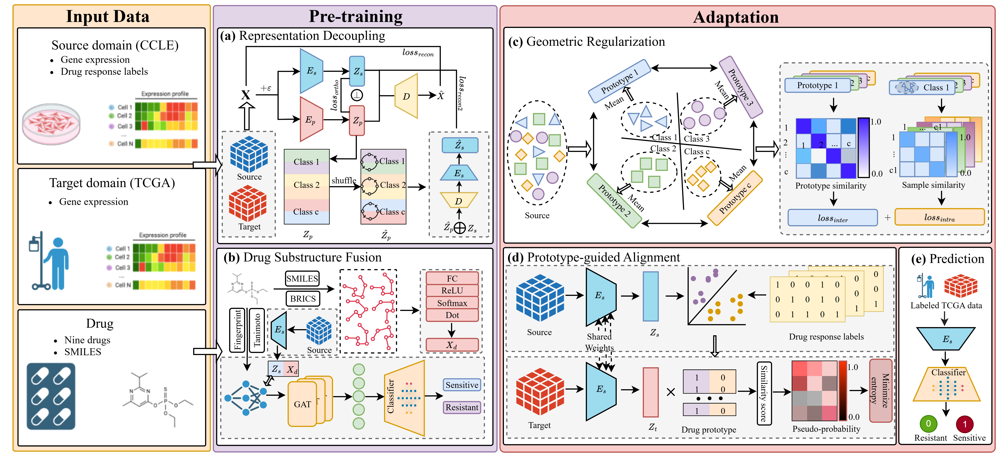

## DRAPE
Source code and data for "Cross-Domain Anticancer Drug Response Prediction via Representation Disentanglement and Prototype Alignment"

## Overview 

DRAPE is a robust cross-domain anticancer drug response prediction framework designed to transfer drug response knowledge from cancer cell lines (CCLE) to patient samples (TCGA). DRAPE adopts a two-stage training strategy that integrates pretraining and unsupervised domain adaptation. It first employs a shared–private representation disentanglement module with perturbation–constraint synergy to separate domain-invariant and domain-specific features while preserving task-relevant information. To enhance drug representation, a BRICS-based molecular decomposition and attention mechanism are introduced to capture informative drug substructures, complemented by a drug similarity graph. Furthermore, geometric regularization promotes intra-class compactness and inter-class separability, while drug-specific prototype alignment and entropy minimization facilitate semantic consistency between source and target domains. An adversarial domain adaptation mechanism further reduces global distribution discrepancies through gradient reversal. Finally, a graph attention network (GAT)-based classifier predicts drug sensitivity for multiple anticancer drugs. By integrating representation disentanglement, drug substructure modeling, geometric constraints, prototype alignment, and adversarial adaptation, DRAPE aims to improve the generalization of drug response prediction from cell lines to patients.

## Installation
1. Install anaconda:
Instructions here: https://www.anaconda.com/download/
2. pip install -r Requirements.txt
3. Run main.py

